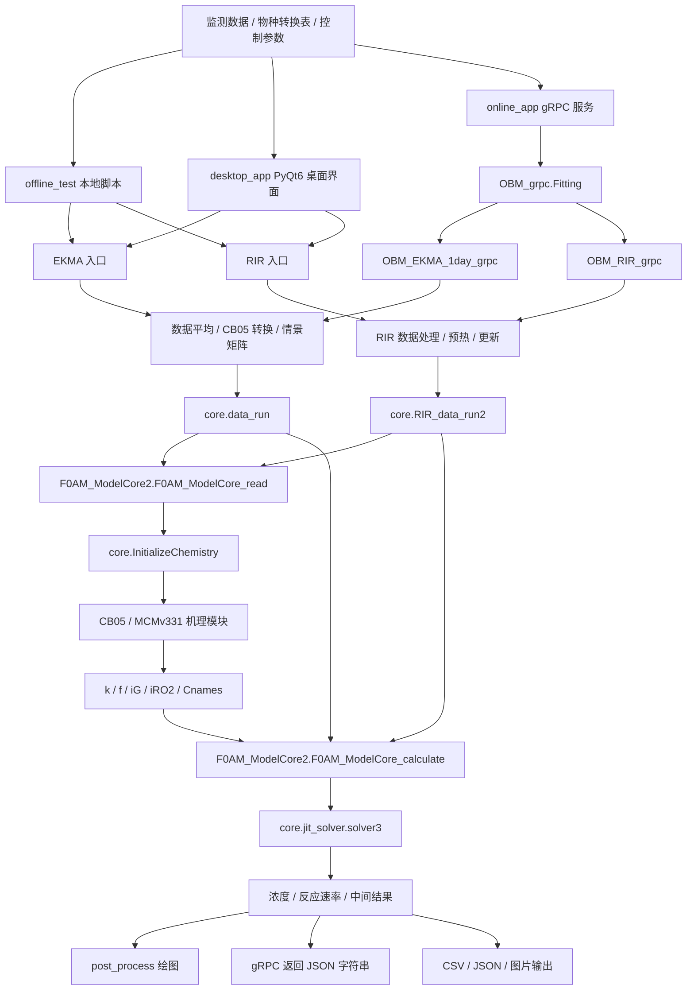
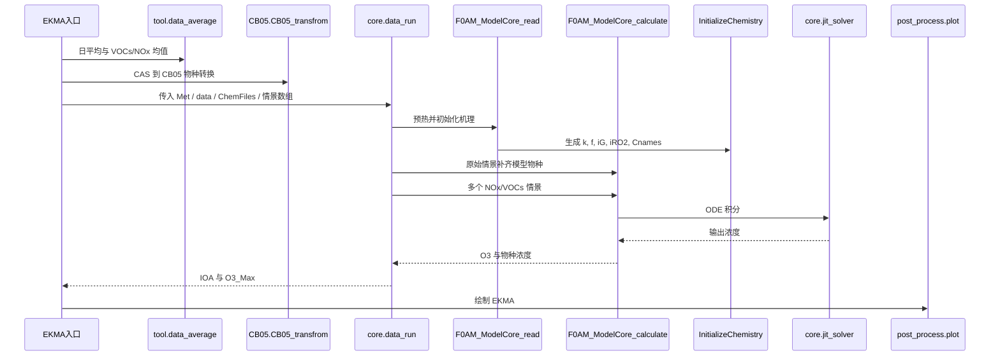
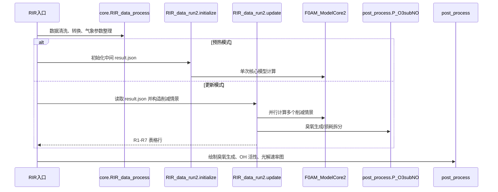
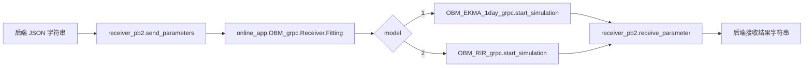

# OBM 程序架构

本文档梳理 OBM Python 版本的主要模块、入口和调用关系。 

## 总览

## 分层说明

| 层级 | 模块 | 说明 |
| --- | --- | --- |
| 入口层 | `offline_test/`、`desktop_app/`、`online_app/` | 负责读取输入、接收参数、选择 EKMA 或 RIR 流程。 |
| 预处理层 | `tool.data_average`、`tool.file_transform`、`CB05.CB05_transfrom`、`core.RIR_data_process` | 处理时间平均、列名转换、CAS 到模型物种映射、气象默认值等。 |
| 计算编排层 | `core.data_run`、`core.RIR_data_run2` | 组织 EKMA 情景矩阵、RIR 预热/更新/削减情景，并调用核心模型。 |
| 化学初始化层 | `core.InitializeChemistry` | 调用 K/J 函数与机理反应模块，生成物种列表、反应速率矩阵、稀疏化学计量矩阵和反应物索引。 |
| 求解层 | `core.F0AM_ModelCore2`、`core.jit_solver`、`core.ode15s`、`core.dydt_eval`、`core.Jac_eval` | 将输入浓度、背景浓度、气象参数与机理参数组装后积分 ODE。 |
| 后处理层 | `post_process.P_O3subNO`、`post_process/` | 计算臭氧生成/损耗、OH 活性、RIR 指标并绘图。 |

## EKMA 调用关系

关键文件：

- `offline_test/OBM_EKMA_1day.py`：线下 EKMA 入口。
- `desktop_app/OBM_EKMA_1day2.py`：桌面版 EKMA 包装。
- `online_app/OBM_EKMA_1day_grpc.py`：线上 EKMA 包装。
- `core/data_run.py`：EKMA 情景编排。

## RIR 调用关系

关键文件：

- `offline_test/OBM_RIR.py`：线下 RIR 入口。
- `desktop_app/OBM_RIR2.py`：桌面版 RIR 包装。
- `online_app/OBM_RIR_grpc.py`：线上 RIR 包装，支持预热、更新与情景削减模式。
- `core/RIR_data_run2.py`：RIR 预热、更新与多日削减情景计算。

## 化学机理初始化

`core.InitializeChemistry.InitializeChemistry` 接收 `Met` 与 `ChemFiles`，执行以下步骤：

1. 添加特殊物种 `ONE` 与 `RO2`。
2. 调用 `ChemFiles[0]` 中的 K 函数，例如 `CB05_K(Met)`。
3. 调用 `ChemFiles[1]` 中的 J 函数，例如 `CB05_J(Met,2)`。
4. 根据输入的 `jcorr` 和显式输入光解速率校正 J 值。
5. 导入反应模块，例如 `CB05.CB05_AllRxns`。
6. 生成并返回：
   - `Cnames`：模型物种名。
   - `Rnames`：反应名。
   - `k`：反应速率常数矩阵。
   - `f`：稀疏化学计量矩阵。
   - `iG`：每个反应的反应物索引。
   - `iRO2`：RO2 物种索引。
   - `jcorr` / `jcorr_all`：光解速率校正因子。

## 核心求解

`core.F0AM_ModelCore2` 被拆成两段：

- `F0AM_ModelCore_read(Met, ChemFiles)`：只做气象参数扩展、数密度/水汽计算和机理初始化，可供多进程情景共享。
- `F0AM_ModelCore_calculate(args)`：接收初始浓度、背景浓度、模型选项和已初始化机理参数，逐时间步调用 `core.jit_solver.solver3`。

`core.jit_solver.solver3` 会优先使用已有的 `core/solver.so`、`core/solver2.so`、`core/solver.pyd` 或 `core/solver2.pyd`。若对应动态库不存在，会基于当前机理和 hold 参数尝试重新编译求解器。

## 线上 gRPC 数据流

`online_app/receiver_pb2.py` 现在提供当前服务实际使用的两个字符串消息：

- `send_parameters(send_string=...)`
- `receive_parameter(receive_string=...)`

## 已知注意事项

- 多个入口脚本保留历史硬编码路径，部署前需要集中配置。
- `online_app/OBM_grpc.py` 有服务器 hash 校验，迁移机器时需要更新。
- `MCMv331` 机理规模远大于 CB05，当前 `jitcode` 动态库方案主要适配 CB05。
- `core/solver.so`、`core/solver2.so`、`core/solver.pyd` 与 `core/solver2.pyd` 是平台相关文件，跨系统或 Python 版本迁移时需要重新验证。
- `post_process/plot.py` 和线上 EKMA 中使用 `scipy.interpolate.interp2d`，若目标环境 SciPy 版本较新，需要额外验证兼容性。
