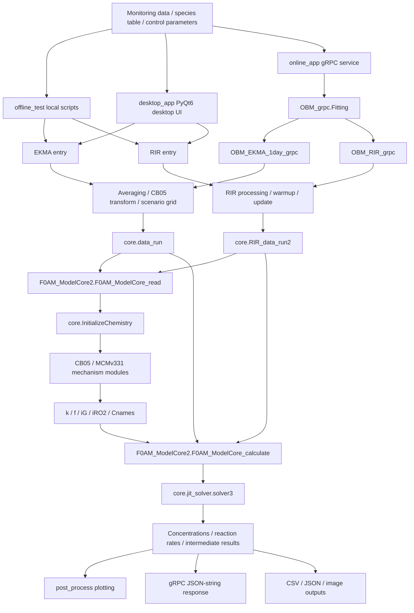
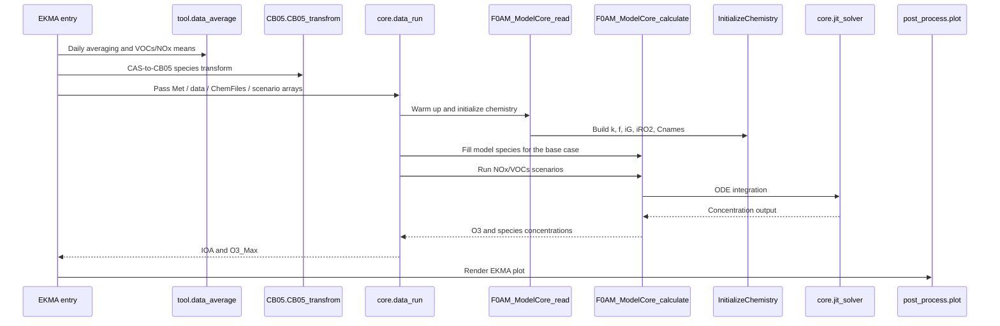
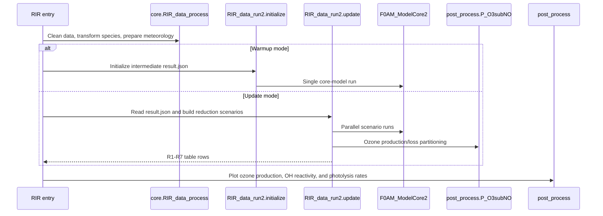

# OBM Program Architecture

This document describes the main modules, entry points, and call relationships in the Python OBM project. Large `txt` and `m` files under `CB05/` and `MCMv331/` were intentionally not inspected during this cleanup.

## Overview

## Layers

| Layer | Modules | Responsibility |
| --- | --- | --- |
| Entry layer | `offline_test/`, `desktop_app/`, `online_app/` | Read inputs, receive parameters, and route to EKMA or RIR. |
| Preprocessing layer | `tool.data_average`, `tool.file_transform`, `CB05.CB05_transfrom`, `core.RIR_data_process` | Time averaging, column conversion, CAS-to-model-species mapping, and default meteorology handling. |
| Orchestration layer | `core.data_run`, `core.RIR_data_run2` | Build EKMA scenario grids, run RIR warmup/update/reduction scenarios, and call the core model. |
| Chemistry initialization layer | `core.InitializeChemistry`, `core.AddSpecies` | Call K/J functions and mechanism modules, then build species lists, rate matrices, stoichiometric matrices, and reactant indices. |
| Solver layer | `core.F0AM_ModelCore2`, `core.jit_solver`, `core.ode15s`, `core.dydt_eval`, `core.Jac_eval` | Assemble concentrations, background terms, meteorology, and mechanism parameters, then integrate the ODE system. |
| Postprocessing layer | `post_process.P_O3subNO`, `post_process/` | Calculate ozone production/loss, OH reactivity, RIR metrics, and plots. |

## EKMA Call Flow

Key files:

- `offline_test/OBM_EKMA_1day.py`: offline EKMA entry.
- `desktop_app/OBM_EKMA_1day2.py`: desktop EKMA wrapper.
- `online_app/OBM_EKMA_1day_grpc.py`: online EKMA wrapper.
- `core/data_run.py`: EKMA scenario orchestration.

## RIR Call Flow

Key files:

- `offline_test/OBM_RIR.py`: offline RIR entry.
- `desktop_app/OBM_RIR2.py`: desktop RIR wrapper.
- `online_app/OBM_RIR_grpc.py`: online RIR wrapper, including warmup, update, and reduction-scenario modes.
- `core/RIR_data_run2.py`: RIR warmup, update, and multi-day reduction-scenario computation.

## Chemistry Initialization

`core.InitializeChemistry.InitializeChemistry` receives `Met` and `ChemFiles`, then:

1. Adds special species `ONE` and `RO2`.
2. Calls the K function in `ChemFiles[0]`, such as `CB05_K(Met)`.
3. Calls the J function in `ChemFiles[1]`, such as `CB05_J(Met,2)`.
4. Corrects J values using `jcorr` and any explicitly provided photolysis rates in `Met`.
5. Imports the mechanism reaction module, such as `CB05.CB05_AllRxns`.
6. Returns `Cnames`, `Rnames`, `k`, `f`, `iG`, `iRO2`, `jcorr`, and `jcorr_all`.

## Core Solver

`core.F0AM_ModelCore2` is split into two phases:

- `F0AM_ModelCore_read(Met, ChemFiles)`: expands meteorological parameters, computes number density and water vapor, and initializes chemistry. This output can be shared across multiprocessing scenarios.
- `F0AM_ModelCore_calculate(args)`: receives initial concentrations, background concentrations, model options, and initialized chemistry parameters, then calls `core.jit_solver.solver3` for each step.

`core.jit_solver.solver3` first looks for compiled solver binaries in `core/`: `solver.so`, `solver2.so`, `solver.pyd`, or `solver2.pyd`. If the required binary is absent, it attempts to compile a solver for the current mechanism and hold-species setting.

## Online gRPC Data Flow

`online_app/receiver_pb2.py` provides the two string messages used by the current service:

- `send_parameters(send_string=...)`
- `receive_parameter(receive_string=...)`

## Important Notes

- Several entry scripts still contain historical hard-coded paths and should be configured before deployment.
- `online_app/OBM_grpc.py` includes a server hardware hash check. Update it when moving to a new machine.
- MCMv331 is much larger than CB05. The current compiled-solver workflow is mainly practical for CB05.
- Compiled solver files are platform-specific and should be revalidated after changing OS or Python version.
- `post_process/plot.py` and online EKMA use `scipy.interpolate.interp2d`; compatibility should be checked if the target SciPy version is new.
